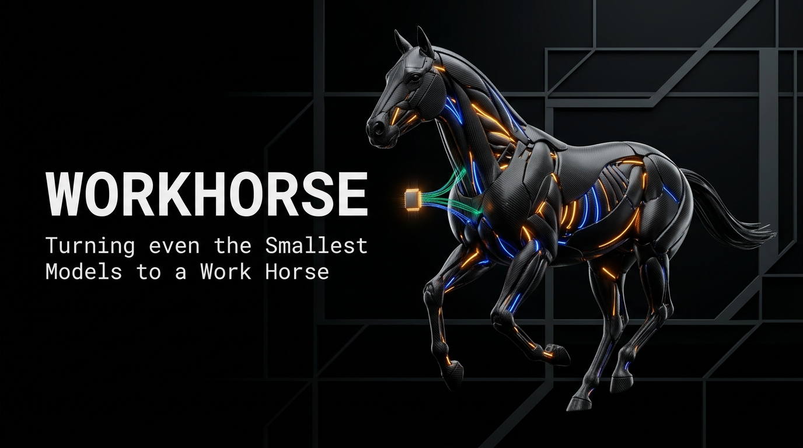

<p align="center">
  
</p>

<p align="center">
  <strong>"Convirtiendo incluso los modelos más pequeños en caballos de batalla"</strong>
</p>

<p align="center">
  <a href="./README.md"><strong>English</strong></a> •
  <a href="./README.es.md"><strong>Español</strong></a> •
  <a href="./README.zh.md"><strong>简体中文</strong></a> •
  <a href="./README.fr.md"><strong>Français</strong></a>
</p>

<p align="center">
  
  
  
  
  
</p>

---

## Visión General

**Workhorse** es una estación de trabajo de terminal híbrida de nivel empresarial y entorno de agentes autónomos que conecta el procesamiento neural local en el dispositivo (Ollama) con clústeres de cómputo en la nube (Groq LPUs, Nvidia NIM, Google Gemini 2.5, OpenRouter), potenciado por investigación web multieje en vivo (Firecrawl, Jina AI, Tavily, You.com) e interoperabilidad de habilidades cruzadas entre agentes.

### Directivas Principales

1. **Invocación Universal mediante Tres Alias:**
   Ejecutable desde _cualquier_ directorio del sistema operativo mediante `workhorse`, `workhouse` o `wh`. Sin argumentos abre la interfaz gráfica de terminal (TUI) a pantalla completa anclada al directorio actual. Con argumentos o tuberías opera en modo CLI sin cabeza.

2. **Operador Activo del Repositorio de Trabajo (Sin Sandboxing Restrictivo):**
   Workhorse NO aísla sus operaciones en una caja de arena artificial. Al invocarse en una carpeta de proyecto, inspecciona el repositorio, procesa archivos por fragmentos y realiza modificaciones en el lugar con copias de seguridad automáticas en `.workhorse_backups/`.

3. **Anillo de Resiliencia Infinito de 5 Ciclos (Cero Fallos Prematuros):**
   Workhorse nunca falla en el primer intento. Recorre la cadena completa de modelos (`Local Ollama` &rarr; `Groq LPU` &rarr; `Nvidia NIM` &rarr; `Google Gemini` &rarr; `OpenRouter`) a lo largo de **5 ciclos completos** con reformulación de instrucciones y retroceso exponencial antes de devolver errores. En ausencia de conexión a internet, se degrada limpiamente al modelo Ollama local.

4. **Acordeones de Pensamiento Transmitidos en Vivo:**
   Workhorse elimina las ruedas giratorias opacas ("pensando...") y las sustituye por menús desplegables interactivos (`ThoughtAccordion`) que transmiten tokens de razonamiento, progreso de fragmentos y llamadas a herramientas en tiempo real.

---

## Identidad Visual: Tema "Obsidian & Neon Industrial"

Workhorse incluye un selector de tema integrado disponible tanto en la terminal (pulsando `F7`) como en la interfaz web:

| Rol                         | Nombre del Color    | Código Hex | Propósito y Estética                                           |
| :-------------------------- | :------------------ | :--------- | :------------------------------------------------------------- |
| **Fondo Principal**         | **OLED Obsidian**   | `#08090A`  | Lienzo negro profundo diseñado para alto contraste.            |
| **Superficie / Paneles**    | **Gunmetal Gray**   | `#141619`  | Elevación sutil para tarjetas, registros y ventanas.           |
| **Acento de Marca (Local)** | **Terminal Amber**  | `#FFB000`  | Tono ámbar clásico CRT que indica ejecución local rápida.      |
| **Acento de Poder (Nube)**  | **Electric Cobalt** | `#2563EB`  | Azul de alto voltaje para razonamiento profundo en la nube.    |
| **Estado / Éxito**          | **Matrix Emerald**  | `#10B981`  | Indicador de herramientas web activas y tokens correctos.      |
| **Tipografía / Texto**      | **Platinum White**  | `#F3F4F6`  | Blanco roto de alta legibilidad para reducir la fatiga visual. |

---

## Instalación Rápida

### Linux y macOS (Una sola línea)

```bash
curl -fsSL https://raw.githubusercontent.com/kingjethro999/workhorse/main/install.sh | bash
```

### Windows PowerShell

```powershell
irm https://raw.githubusercontent.com/kingjethro999/workhorse/main/install.ps1 | iex
```

---

## Atajos de Teclado en la TUI

- `F1`: Ayuda y documentación
- `F2`: Cambiar modo (`auto:auto`, `local`, `groq`, `nvidia`, `gemini`, `openrouter`)
- `F3`: Activar/desactivar búsqueda web
- `F4`: Selector de modelos
- `F5`: Limpiar historial
- `F6`: Hub de habilidades y MCP
- `F7`: Alternar tema (Obsidian &amp; Neon Industrial)
- `Ctrl+B`: Mostrar/ocultar barra lateral
- `Ctrl+Q`: Salir

---

## Licencia

Workhorse se distribuye bajo los términos de la [Licencia Apache, Versión 2.0](./LICENSE).
