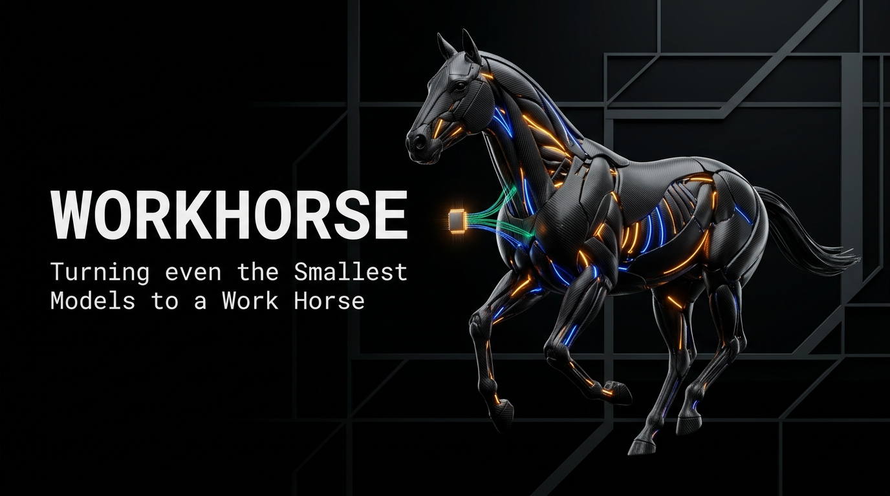

<p align="center">
  
</p>

<p align="center">
  <strong>« Transformer même les plus petits modèles en véritables bêtes de somme »</strong>
</p>

<p align="center">
  <a href="./README.md"><strong>English</strong></a> •
  <a href="./README.es.md"><strong>Español</strong></a> •
  <a href="./README.zh.md"><strong>简体中文</strong></a> •
  <a href="./README.fr.md"><strong>Français</strong></a>
</p>

<p align="center">
  
  
  
  
  
</p>

---

## Présentation

**Workhorse** est un poste de travail terminal hybride d'entreprise et un environnement d'exécution pour agents autonomes. Il associe le traitement neuronal local sur appareil (Ollama) à des clusters de calcul dans le cloud (Groq LPU, Nvidia NIM, Google Gemini 2.5, OpenRouter), complété par une recherche web multi-moteurs en temps réel (Firecrawl, Jina AI, Tavily, You.com) et le partage de compétences inter-agents.

### Directives Fondamentales

1. **Ubiquité Terminale et Invocation par Trois Alias :**
   Exécutable depuis *n'importe quel* répertoire via `workhorse`, `workhouse` ou `wh`. Lancé sans argument, il démarre l'interface graphique de terminal (TUI) plein écran Textual, ancrée dans le répertoire courant. Avec des arguments ou des flux redirigés, il bascule instantanément en mode CLI direct.

2. **Opérateur Actif sur le Dépôt de Travail :**
   Workhorse ne s'enferme pas dans un bac à sable artificiel. Il inspecte directement les sources, analyse l'AST et modifie les fichiers sur place avec des sauvegardes automatiques dans `.workhorse_backups/`.

3. **Anneau de Résilience 5 Cycles (Zéro Abandon Prématuré) :**
   Workhorse ne renonce jamais sur une simple erreur de réseau ou de quota. Il parcourt la chaîne (`Ollama Local` &rarr; `Groq LPU` &rarr; `Nvidia NIM` &rarr; `Google Gemini` &rarr; `OpenRouter`) pendant **5 cycles complets** avant de renvoyer une erreur. En mode hors ligne, il bascule sans interruption vers le modèle local Ollama.

4. **Accordéons de Pensée en Streaming Direct :**
   Finis les indicateurs de chargement opaques. Workhorse diffuse les jetons de raisonnement, les étapes de découpage et les appels d'outils dans des menus déroulants interactifs (`ThoughtAccordion`).

---

## Identité Visuelle : Thème « Obsidienne et Néon Industriel »

Workhorse propose un basculement de thème natif dans le terminal (`F7`) et sur l'interface Web :

| Rôle | Nom de Couleur | Code Hex | Intention et Rendu Visuel |
| :--- | :--- | :--- | :--- |
| **Arrière-plan Principal** | **OLED Obsidian** | `#08090A` | Toile noire pure conçue pour un contraste élevé. |
| **Surfaces et Panneaux** | **Gunmetal Gray** | `#141619` | Élévation subtile pour cartes, fenêtres et journaux. |
| **Accent Local** | **Terminal Amber** | `#FFB000` | Ambre CRT rétro signalant une exécution locale rapide. |
| **Accent Cloud** | **Electric Cobalt** | `#2563EB` | Bleu haute tension pour le raisonnement approfondi dans le cloud. |
| **Statut et Succès** | **Matrix Emerald** | `#10B981` | Vert émeraude pour la recherche web et les tokens validés. |
| **Typographie** | **Platinum White** | `#F3F4F6` | Blanc cassé assurant une lisibilité maximale sans fatigue. |

---

## Installation Rapide

### Linux et macOS
```bash
curl -fsSL https://raw.githubusercontent.com/kingjethro999/workhorse/main/install.sh | bash
```

### Windows PowerShell
```powershell
irm https://raw.githubusercontent.com/kingjethro999/workhorse/main/install.ps1 | iex
```

---

## Raccourcis Clavier Principaux (TUI)
- `F1` : Aide et documentation
- `F2` : Changer de mode d'exécution
- `F3` : Activer/désactiver la recherche web
- `F4` : Sélecteur de modèle
- `F5` : Effacer l'historique
- `F6` : Hub de compétences et serveurs MCP
- `F7` : Basculer le thème (Obsidienne et Néon)
- `Ctrl+B` : Afficher/masquer l'explorateur de fichiers
- `Ctrl+Q` : Quitter

---

## Licence

Workhorse est distribué sous les termes de la [Licence Apache 2.0](./LICENSE).
