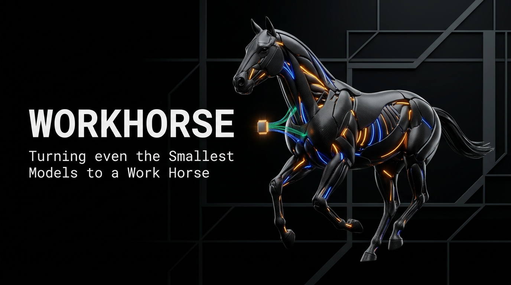

<p align="center">
  
</p>

<p align="center">
  <strong>"Turning even the Smallest Models to a Work Horse"</strong>
</p>

<p align="center">
  <a href="./README.md"><strong>English</strong></a> •
  <a href="./README.es.md"><strong>Español</strong></a> •
  <a href="./README.zh.md"><strong>简体中文</strong></a> •
  <a href="./README.fr.md"><strong>Français</strong></a>
</p>

<p align="center">
  
  
  
  
  
</p>

---

## Overview

**Workhorse** is an enterprise-grade hybrid terminal workstation and autonomous agent runtime that bridges on-device neural processing (Ollama) with cloud compute clusters (Groq LPUs, Nvidia NIM, Google Gemini 2.5, OpenRouter), augmented by live multi-engine web research (Firecrawl, Jina AI, Tavily, You.com) and cross-agent skills interoperability.

### Core Directives

1. **Zero-Friction Terminal Ubiquity & Tri-Alias Invocation:**
   Executable from _any_ directory on the operating system via `workhorse`, `workhouse`, or `wh`. Invoking without arguments enters the full-screen Textual Terminal GUI (TUI), anchored directly to the user's active directory. Passing arguments, flags, or pipes immediately executes in headless CLI mode.

2. **Active Working Repository Operator (No Restrictive Sandboxing):**
   Workhorse does NOT trap operations in an isolated sandbox. When invoked in any project folder, it has authority to inspect the repository, read source files in chunks, and actively edit files in-place with automatic safety backups stored in `.workhorse_backups/`.

3. **5-Cycle Infinite Resilience Ring (Zero Premature Failures):**
   Workhorse never gives up on a single error. It traverses its entire model chain (`Local Ollama` &rarr; `Groq LPU` &rarr; `Nvidia NIM` &rarr; `Google Gemini` &rarr; `OpenRouter`) across **5 complete cycles** with prompt reformulation and exponential backoff before returning errors. If offline, it immediately degrades to local Ollama.

4. **Live Streaming Thought Accordions (No Opaque Spinners):**
   Workhorse replaces opaque "loading..." spinners with interactive, collapsible disclosure dropdowns (`ThoughtAccordion`) streaming reasoning tokens, chunk status, and tool calls in real time.

---

## Visual Identity: The "Obsidian & Neon Industrial" Theme

Workhorse includes a built-in theme switch available in both the Terminal GUI (press `F7`) and the Web Interface:

| Role                          | Color Name          | Hex Code  | Aesthetic & Functional Vibe                                            |
| :---------------------------- | :------------------ | :-------- | :--------------------------------------------------------------------- |
| **Primary / Background**      | **OLED Obsidian**   | `#08090A` | Deep, true-black canvas designed for high-contrast focus.              |
| **Surface / Containers**      | **Gunmetal Gray**   | `#141619` | Subtle elevation for cards, logs, and terminal window panes.           |
| **Brand Accent (Fast/Local)** | **Terminal Amber**  | `#FFB000` | Classic amber CRT tone signaling fast, local execution.                |
| **Power Accent (Cloud/Exec)** | **Electric Cobalt** | `#2563EB` | High-voltage blue representing deep cloud reasoning and heavy lifting. |
| **Success / Live Status**     | **Matrix Emerald**  | `#10B981` | Clean indicator for active web intelligence and successful tokens.     |
| **Typography / Text**         | **Platinum White**  | `#F3F4F6` | High-legibility off-white reducing eye strain during long sessions.    |

The dual-engine signal uses **Terminal Amber** for local tasks and **Electric Cobalt** for cloud routing, creating an instant visual cue of where compute is happening.

---

## Quick Start & Installation

### One-Line Install (Linux / macOS)

```bash
curl -fsSL https://raw.githubusercontent.com/kingjethro999/workhorse/main/install.sh | bash
```

### Windows PowerShell

```powershell
irm https://raw.githubusercontent.com/kingjethro999/workhorse/main/install.ps1 | iex
```

### Manual Setup

```bash
git clone https://github.com/kingjethro999/workhorse.git
cd workhorse
python3 -m venv .venv
source .venv/bin/activate
pip install -e .
```

---

## Usage

### Interactive Terminal GUI (TUI)

Simply run any of the aliases in your target repository:

```bash
wh
# or
workhorse
# or
workhouse
```

#### TUI Keyboard Shortcuts

- `F1`: Help & Documentation
- `F2`: Cycle Execution Mode (`auto:auto`, `local`, `groq`, `nvidia`, `gemini`, `openrouter`)
- `F3`: Toggle Live Web Intelligence (Firecrawl, Jina, Tavily, You.com)
- `F4`: Model Selector Modal
- `F5`: Clear Chat History
- `F6`: Cross-Agent Skills & MCP Hub
- `F7`: Theme Switcher (Toggle Obsidian &amp; Neon Industrial)
- `Ctrl+B`: Toggle Workspace Sidebar
- `Ctrl+Q`: Quit

### Headless CLI Mode

```bash
# Execute prompt in current directory
wh "explain this repository architecture"

# In-place file modification
wh "rewrite README.md with detailed setup instructions"

# Pipe code into Workhorse
cat main.py | wh "optimize performance and add type hints"
```

---

## Web Showcase Interface

Workhorse features a public product portal in `/web` built with Next.js, Tailwind CSS, and Three.js/Canvas:

- Interactive Cybernetic Workhorse mascot with kinetic trots and WCAG 2.2.2 pause/play control.
- Live Terminal Simulator replay.
- One-Click Installation Bar.
- 5-Cycle Resilience Ring Visualizer.
- Built-in theme switcher matching the Obsidian &amp; Neon Industrial identity.

To launch the web interface:

```bash
cd web
zyrk install
npm run dev
```

---

## Git Commit Version Bumper Hook

Workhorse comes with an automated commit version bumper:

- Normal commit: bumps patch (+0.0.1)
- On every `x.x.9`: rolls over to `x.(x+1).0`
- On every `x.599.9`: rolls over to `(x+1).0.0`

Install the hook:

```bash
cp scripts/git-hooks/pre-commit .git/hooks/pre-commit
chmod +x .git/hooks/pre-commit
```

---

## License

Workhorse is licensed under the [Apache License, Version 2.0](./LICENSE).
