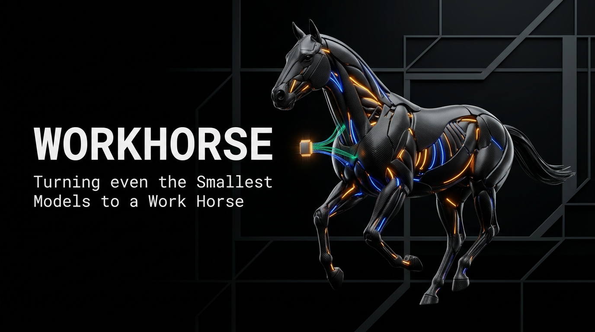

<p align="center">
  
</p>

<p align="center">
  <strong>"将哪怕最小的模型打造成强大的主力战马"</strong>
</p>

<p align="center">
  <a href="./README.md"><strong>English</strong></a> •
  <a href="./README.es.md"><strong>Español</strong></a> •
  <a href="./README.zh.md"><strong>简体中文</strong></a> •
  <a href="./README.fr.md"><strong>Français</strong></a>
</p>

<p align="center">
  
  
  
  
  
</p>

---

## 项目概述

**Workhorse**（战马）是一款企业级混合智能终端工作站与自主代理运行环境。它将本地设备端神经处理（Ollama）与云端集群（Groq LPU、Nvidia NIM、Google Gemini 2.5、OpenRouter）紧密结合，并整合实时多引擎网络搜索（Firecrawl、Jina AI、Tavily、You.com）及跨智能体技能共享协议。

### 核心设计原则

1. **零阻力全系统终端调用（三大别名）：**
   可在操作系统的任意目录下通过 `workhorse`、`workhouse` 或 `wh` 快速执行。无参数调用时直接启动全屏 Textual 终端图形界面（TUI），并自动将上下文锚定于当前工作目录；带有参数或管道输入时立即以命令行模式运行。

2. **真实活动仓库代码操作（无人工沙箱限制）：**
   Workhorse 绝非将操作限制在隔离沙箱中的普通聊天工具。它直接对当前工作区进行 AST 语法分析、分块检索与就地代码编辑，并在 `.workhorse_backups/` 中自动保存带时间戳的安全备份。

3. **5周期无限弹性韧性环（零过早故障）：**
   Workhorse 遇到单次错误绝不轻易放弃。它会在模型环路（`本地 Ollama` &rarr; `Groq LPU` &rarr; `Nvidia NIM` &rarr; `Google Gemini` &rarr; `OpenRouter`）中自动遍历并完成多达 **5轮完整重试**，结合提示词重构与指数退避。在离线状态下自动平滑降级至本地 Ollama 模型。

4. **实时流式思维折叠面板（杜绝黑盒加载动画）：**
   摒弃静态的“思考中...”等待指示器，采用实时可折叠展开面板（`ThoughtAccordion`），将推理过程 Token、分块读取进度、工具调用与 Diff 预览透明呈现给开发者。

---

## 视觉体系：“黑曜石与霓虹工业”主题

Workhorse 提供原生主题切换，支持在终端界面（按 `F7`）和 Web 展示页面中一键切换：

| 角色           | 颜色名称            | 十六进制色值 | 设计意图与审美效果                               |
| :------------- | :------------------ | :----------- | :----------------------------------------------- |
| **主背景**     | **OLED Obsidian**   | `#08090A`    | 纯黑画布，为 OLED 设备优化并提供极佳视觉聚焦。   |
| **容器与面板** | **Gunmetal Gray**   | `#141619`    | 层次感微妙的金属灰底色，用于卡片与日志面板。     |
| **本地强调色** | **Terminal Amber**  | `#FFB000`    | 经典复古琥珀色终端荧光，直观指示本地执行。       |
| **云端强调色** | **Electric Cobalt** | `#2563EB`    | 象征高压云端深度推理与大模型算力的高电压电光蓝。 |
| **运行状态**   | **Matrix Emerald**  | `#10B981`    | 清晰指示网络检索与 Token 流式传输成功的矩阵绿。  |
| **正文字体**   | **Platinum White**  | `#F3F4F6`    | 高易读性的浅白文字，减轻长时间阅读疲劳。         |

---

## 一键安装

### Linux / macOS

```bash
curl -fsSL https://raw.githubusercontent.com/kingjethro999/workhorse/main/install.sh | bash
```

### Windows PowerShell

```powershell
irm https://raw.githubusercontent.com/kingjethro999/workhorse/main/install.ps1 | iex
```

---

## 快捷键参考 (TUI)

- `F1`: 帮助与快捷键文档
- `F2`: 切换调度模式 (`auto:auto`, `local`, `groq`, `nvidia`, `gemini`, `openrouter`)
- `F3`: 切换实时网络智能搜索
- `F4`: 模型选择弹窗
- `F5`: 清空会话历史
- `F6`: 跨智能体技能与 MCP 中心
- `F7`: 切换主题（黑曜石与霓虹工业）
- `Ctrl+B`: 折叠/展开工作区文件树
- `Ctrl+Q`: 退出

---

## 开源协议

Workhorse 基于 [Apache License 2.0](./LICENSE) 协议发布。
